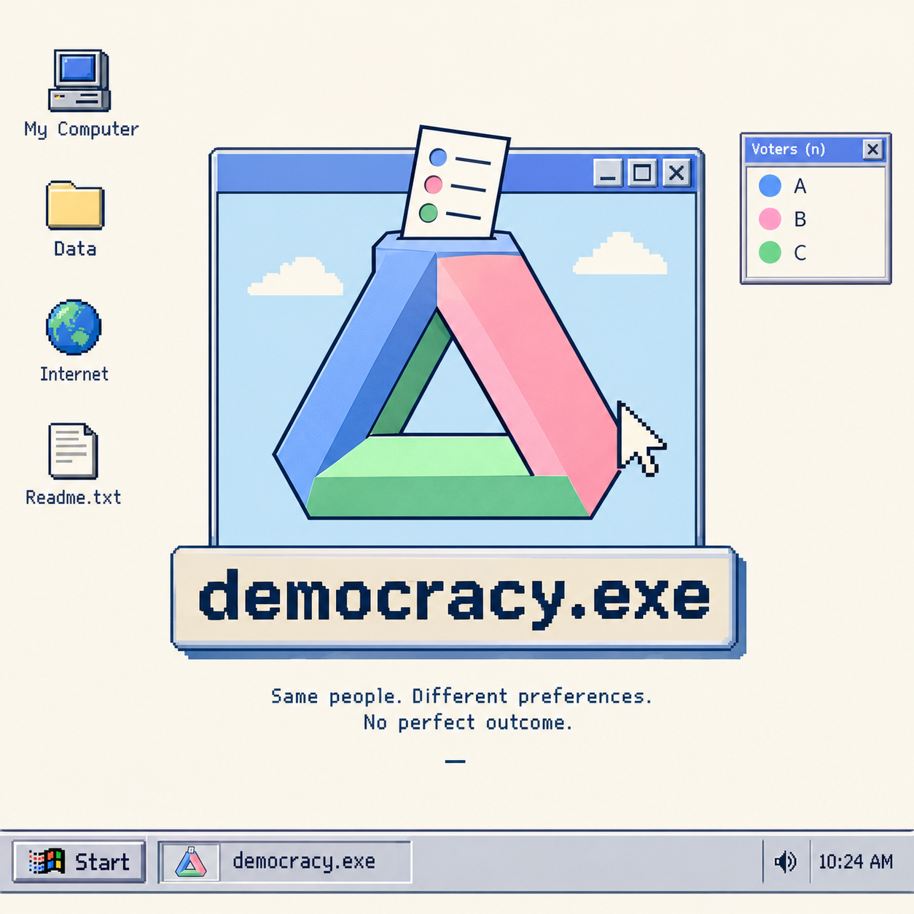

<p align="center">
  
</p>

# democracy.exe

An interactive exploration of voting: the same people, the same preferences, and different winners depending on how votes are counted.

Choose a candidate, rank your favourites, and compare first-choice voting, instant runoff, and points (Borda). In the playground, try one school or simulate 1,000 with random voters, voters on a spectrum, or fictional AI students who explain their choices.

Built with Next.js, React, TypeScript, Tailwind CSS, and shadcn/ui. The app works offline once installed and built. All candidates and student data are fictional; AI student responses are generated ahead of time, with no live AI calls in the app.

## Run locally

Requires Node.js 22.18 or newer.

```sh
npm install
npm run dev
```

Open [localhost:3000](http://localhost:3000).

For a production build:

```sh
npm run build
npm start
```

## Generate AI students

With the Codex CLI installed and signed in, generate a pool using GPT-6-Luna at medium reasoning:

```sh
npm run students
```

This replaces `src/lib/ai-students.json`. To try a smaller sample in a separate file:

```sh
npm run students -- 30 /tmp/students-trial.json
```

## Checks

```sh
npm test
npm run typecheck
npm run lint
npm run build
```
